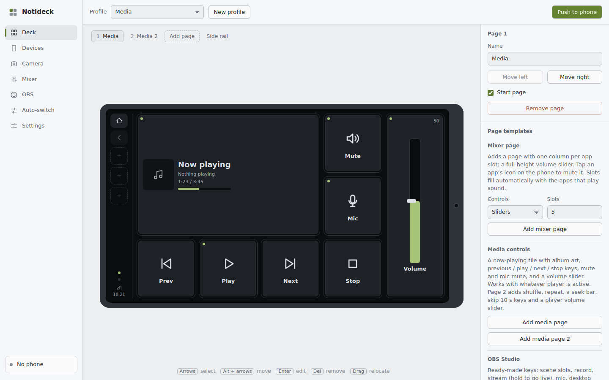
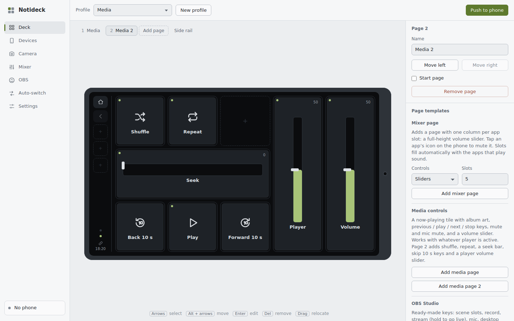
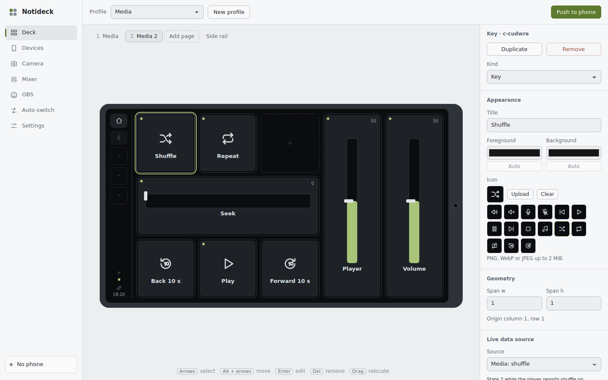
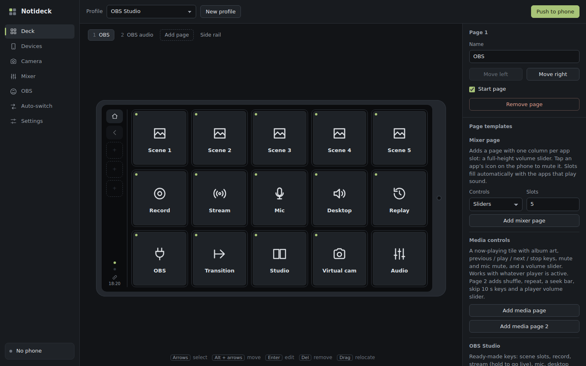
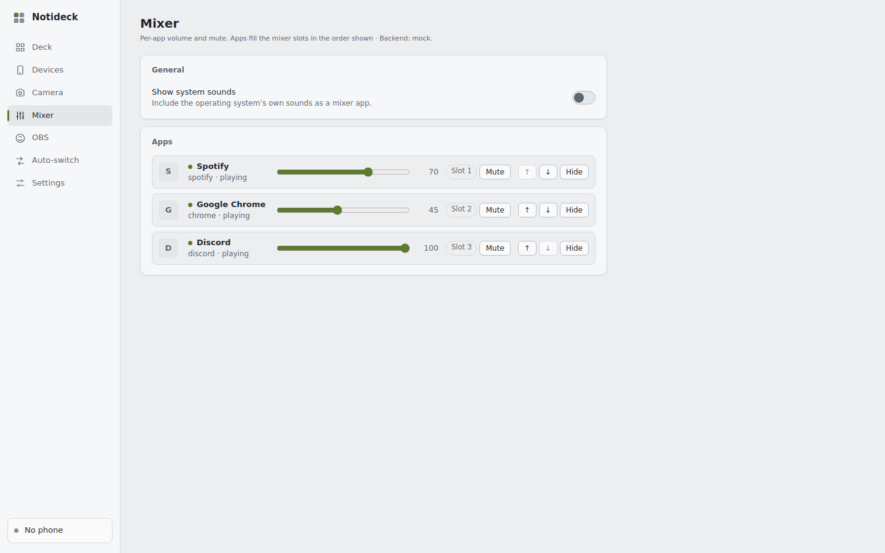
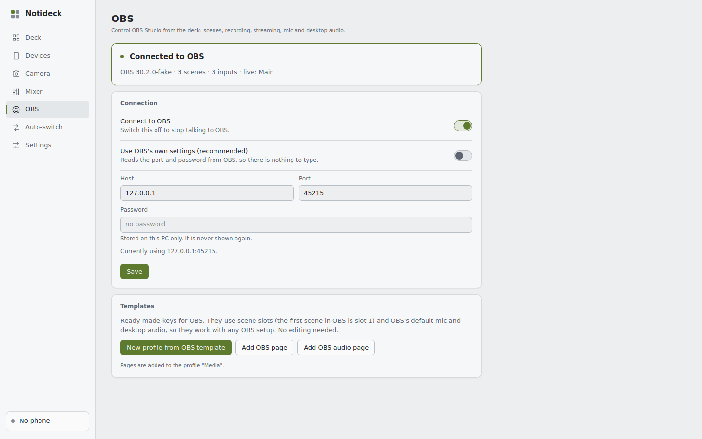
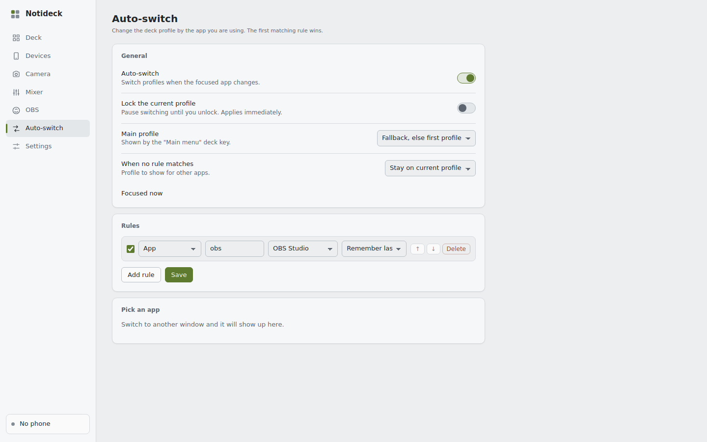
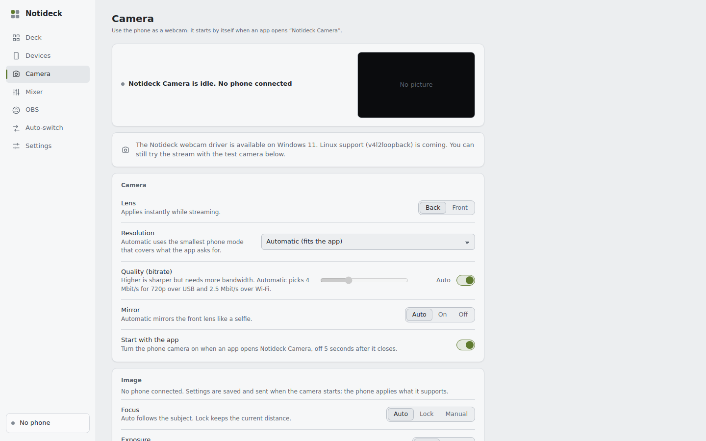

# Notideck

[](https://github.com/notifice/notideck/actions/workflows/ci.yml)
[](https://github.com/notifice/notideck/releases/latest)

> [!IMPORTANT]
> **Made with AI.** Almost all of the code, docs and tests in this project were written by an AI model (Anthropic's
> Claude, through Claude Code), directed by me. I am not a professional software engineer, and no human expert has
> reviewed or audited the code. It works on my own hardware, but it may have bugs or security issues I can't spot.
> If you'd rather not run AI-written software (especially something that sends keyboard input and opens network
> connections on your PC), please don't use it. Like any GPL software, it comes with no warranty.

Notideck turns an old Android phone (Android 8+) into a Stream Deck-style controller, webcam and microphone for Windows and Linux PCs. The phone shows keys, dials and sliders that press hotkeys, control volume and media, run OBS, launch apps and call plugins. It connects over USB (`adb reverse`) or Wi-Fi (TLS, paired once with a QR code). You set the deck up in a config page served by the PC agent.

Licence: GPL-3.0-or-later. Release notes: [`CHANGELOG.md`](CHANGELOG.md).

## Features

- Deck with keys, dials, sliders, live tiles, icons, pages, folders, page swipe and a side rail.
- Profiles and a browser-based editor, with templates for OBS, media, Spotify, VS Code, Discord, TeamSpeak, Photoshop, GIMP, Premiere Pro and DaVinci Resolve.
- Actions: hotkeys, type text, open URL, launch app, run command, volume, media, OBS, plugins.
- Per-app volume mixer (Windows: WASAPI; Linux: `pactl`, no meters).
- Media session control: now playing, transport, seek, shuffle, repeat, player volume (Windows GSMTC, Linux MPRIS).
- Auto profile switching by focused app (Windows; Linux on KDE Plasma Wayland, Sway, Hyprland and X11; not GNOME Wayland yet).
- OBS Studio control over obs-websocket.
- Webcam: the phone camera as "Notideck Camera" in Zoom, Discord, OBS, browsers and more, with lens, torch, zoom and image settings. Windows 11 uses its virtual camera API; Linux uses the v4l2loopback kernel module (one-time setup from the Camera tab).
- Microphone: the phone mic as an input for Discord, OBS, Zoom and more. Linux gets a "Notideck Microphone" device (PipeWire or PulseAudio). Windows needs the free virtual audio cable **[VB-CABLE](https://vb-audio.com/Cable/)** (download, unzip, run `VBCABLE_Setup_x64.exe` as administrator, then pick "CABLE Output" in your app; steps in the [user guide](docs/USER-GUIDE.md#microphone)).
- Camera preview tile on the deck, and deck sleep (black screen with a faint clock after 2 minutes idle; first touch wakes it).
- Native app window and tray icon on Windows and Linux.
- Plugins: bundled Clock & Timer, HTTP request and Weather; your own plugins in any language.
- USB and Wi-Fi connection, mDNS discovery, QR pairing, mutual TLS.
- First-run setup wizard that installs the phone app over USB.

## Screenshots

The config UI runs in the browser (or the Windows app window). These were taken with demo data (fake mixer apps,
fake OBS, no phone connected).

| | |
|---|---|
|  |  |
| Media page template | Media 2 page template |
|  |  |
| Control inspector | OBS template (dark theme) |
|  |  |
| Per-app mixer | OBS connection |
|  |  |
| Auto profile switching | Webcam settings |

## Download and install

Get them from the [Releases page](https://github.com/notifice/notideck/releases/latest) (check files against `SHA256SUMS`): Windows setup program and zip, Linux AppImage and tarball, and the phone APK. Requirements: Android 8+ phone; Windows 10/11 (webcam needs Windows 11) or Linux x86_64.

- Windows: [setup program or portable zip](docs/USER-GUIDE.md#install-on-windows).
- Linux: [AppImage or tarball with `install.sh`](docs/USER-GUIDE.md#install-on-linux), plus [keyboard access](docs/USER-GUIDE.md#keyboard-access).
- Then follow [First run](docs/USER-GUIDE.md#first-run): install the phone app, connect over USB or Wi-Fi.

The full manual is [`docs/USER-GUIDE.md`](docs/USER-GUIDE.md). To write plugins, see [`docs/PLUGINS.md`](docs/PLUGINS.md).

## Build from source

Prerequisites: Rust stable (1.89+), JDK 17, Android SDK 34. `protoc` is vendored. On Linux the desktop window and tray also need the GTK 3, WebKitGTK 4.1, Ayatana AppIndicator, D-Bus and udev development packages (Debian/Ubuntu: `libgtk-3-dev libwebkit2gtk-4.1-dev libayatana-appindicator3-dev libdbus-1-dev libudev-dev pkg-config`).

```sh
git clone https://github.com/notifice/notideck.git
cd notideck

# Host agent
cd host && cargo test --workspace

# Phone app
cd ../android && ./gradlew assembleDebug testDebugUnitTest
```

Release packages:

| Script | Output |
|---|---|
| `scripts/build-windows.sh` | Cross-builds from WSL or Linux (needs `mingw-w64`, the `x86_64-pc-windows-gnu` rustup target, and `nsis` for the installer). Writes the portable folder, the zip and the NSIS `setup.exe` to `dist/`. Flags: `--apk <path>`, `--no-installer`, `--copy-to-desktop`, `--refresh-adb`. |
| `scripts/build-linux.sh` | Writes the tarball (with `install.sh` and `uninstall.sh`) and the AppImage to `dist/`. Flags: `--no-appimage`, `--refresh-adb`. |
| `scripts/release.sh` | Runs all checks and builds every release artefact into `dist/` (with `SHA256SUMS`). |
| `scripts/set-version.sh X.Y.Z` | Sets the version in the host workspace and the Android app. |

Downloaded tools (platform-tools, appimagetool) are cached in `packaging/*/vendor/`. See [`packaging/linux/README`](packaging/linux/README) for Linux details.

## Development

The spec is [`docs/SPEC.md`](docs/SPEC.md) (decisions in section 14). Architecture decisions are in [`docs/adr/`](docs/adr/).

### Notes

- `nd-fakephone` is a headless fake phone for integration tests. Run test agents with `NOTIDECK_NO_ADB=1` so they don't grab a real phone.
- Windows-specific code (SendInput, WASAPI, GSMTC, MF virtual camera) only runs on Windows. From WSL, interop runs the cross-built test exes: `cargo test --target x86_64-pc-windows-gnu`.
- CI (`.github/workflows/ci.yml`) runs fmt, clippy and tests on Linux and Windows plus the Android build. Pushing a `v*` tag runs `.github/workflows/release.yml`, which builds every package and attaches it to a GitHub Release.

## Layout

| Path | Contents |
|---|---|
| `android/` | Phone app (Kotlin + Compose) |
| `host/` | Cargo workspace: `nd-agent` (binary), `nd-core` (profiles, actions, router), `nd-transport` (adb, TLS, pairing), `nd-platform` (input, audio, media, focus), `nd-media` (video pipeline), `nd-vcam` / `nd-vcam-dll` (Windows virtual camera), `nd-obs`, `nd-config`, `nd-plugin`, `nd-proto`, `nd-fakephone` |
| `host/ui/` | Config UI (web SPA, embedded in the agent) |
| `proto/` | Shared protobuf schema (control + media) |
| `packaging/` | Windows NSIS installer, Linux install files, icon generator |
| `host/plugins/` | Bundled plugins (clock, http, weather) |
| `scripts/` | Build and release scripts |
| `docs/` | Spec, user guide, plugin guide, ADRs |

## Licence

GPL-3.0-or-later. See [`LICENSE`](LICENSE).

## Thanks

Notideck is built on open-source work by many people: Rust and its crates (Tokio, axum, rustls, ring, serde, wry and
tao from the Tauri project, windows-rs and hundreds more), Kotlin, Jetpack Compose, CameraX, Media3 ExoPlayer, Square's
Wire, Conscrypt, ZXing, Google's Android platform-tools, NSIS and AppImage. Weather data comes from
[Open-Meteo.com](https://open-meteo.com/) (CC BY 4.0). Thank you all.

The full list with licences is in [`THIRD_PARTY.md`](THIRD_PARTY.md). Every release package also includes
`THIRD_PARTY_LICENSES.txt` with the complete licence texts.
