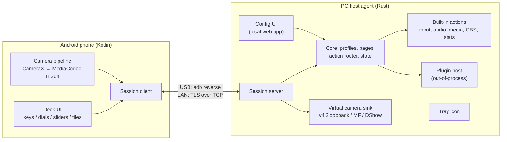
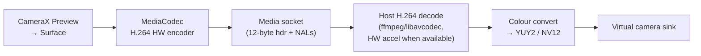

# Notideck — Specification v0.1

> Turn an old Android phone (Android 8+) into a Stream Deck–class control surface and webcam for Windows and Linux PCs, connected over USB or local network.

Status: **Draft** · Last updated: 2026-10-11

---

## 1. Goals & Non-Goals

### Goals
1. **Control surface**: a grid of touch keys, plus **dials (knobs)**, **sliders (faders)** and **live tiles**, that trigger actions on the PC.
2. **Cross-platform host**: Windows 10/11 and Linux (X11 + Wayland) at the same feature level wherever the OS allows it.
3. **Transports**: USB (primary, lowest latency) and LAN (Wi-Fi/Ethernet). Switching between them is invisible to the user.
4. **Webcam**: the phone's camera shows up as a standard system webcam on the PC (Zoom, Discord, OBS, browsers).
5. **Integrations**: OBS Studio, system/per-app audio mixer, media/now-playing, system stats.
6. **Profiles**: multi-page profiles with folders, which switch automatically based on the focused application.
7. **Extensibility**: plugins written in any language add custom actions and tiles.
8. **Old-hardware friendly**: runs well on a ~2018 phone with 2–3 GB of RAM, and stays plugged in 24/7 without problems.

### Non-Goals (v1)
- iOS client.
- macOS host. The architecture allows it, but it isn't tested or shipped.
- Phone-as-microphone. Planned for after v1 (see §13).
- Cloud sync and accounts. Everything stays local.
- Running Elgato Stream Deck SDK plugins as-is. This is a possible stretch goal (§13).

### Prior Art (for reference and to avoid reinventing)
| Project | Relevance |
|---|---|
| **scrcpy** | Proven scheme: H.264 over an `adb` socket, plus camera mirroring. Reference for the media framing and the adb transport. |
| **OpenDeck** | Rust/Tauri Stream Deck software that runs Elgato plugins. Reference for the plugin model. |
| **DroidCam / Iriun** | Phone-as-webcam UX and virtual camera drivers. |
| **Macro Deck / Deckboard / Touch Portal** | Phone-as-deck UX. |

---

## 2. System Overview



**Core principle: the host is the source of truth.** The phone is a smart terminal. It renders what the host tells it to and reports input events back. All configuration, profiles and action logic live on the PC. This keeps the phone app simple and replaceable, so more than one phone (or a tablet) can connect to the same host.

---

## 3. Components

### 3.1 Android app — `android/`
| Item | Decision |
|---|---|
| Language / UI | Kotlin, Jetpack Compose (Material 3) |
| minSdk / targetSdk | **26** / 34 |
| Camera | CameraX (handles LEGACY/LIMITED Camera2 devices) |
| Encoder | `MediaCodec` hardware H.264 (Baseline/Main), Surface input |
| Networking | Coroutines + plain `java.net` sockets; TLS via platform `SSLSocket` with a pinned certificate |
| Serialization | Protobuf (Wire or protobuf-lite), generated from `proto/` |
| Discovery | `NsdManager` (mDNS) |
| Background | Foreground service (`connectedDevice` + `camera` types) owns the session and the camera |

Responsibilities:
- Render the deck layout pushed by the host and send touch, dial and slider events back.
- Cache icons by content hash, so each icon crosses the link only once.
- Run the camera → encoder → stream pipeline when the host requests it.
- **Kiosk/appliance mode**: immersive fullscreen, keep screen on, optional auto-launch when USB power is connected, dim after idle and wake on touch, "pin app" guidance.
- Health reporting: battery level/temperature, charging state, thermal throttling (via battery temperature, because `PowerManager` thermal status needs API 29+).

### 3.2 Host agent — `host/` (Rust cargo workspace)
| Crate | Purpose |
|---|---|
| `nd-proto` | Generated protobuf types (`prost`) and framing codec |
| `nd-core` | Profiles, pages, action router, state store, event bus. **Pure logic, no OS calls**, so it's fully unit-testable |
| `nd-platform` | Traits + per-OS implementations: input injection, audio, media sessions, focused window, notifications |
| `nd-transport` | USB (adb) device tracking, LAN listener, TLS, mDNS advertisement, pairing |
| `nd-media` | H.264 decode → frames for the virtual camera |
| `nd-vcam` | Virtual camera sinks (Linux v4l2loopback, Windows MF/DShow) |
| `nd-obs` | obs-websocket v5 client |
| `nd-plugin` | Plugin process manager + JSON-RPC bridge |
| `nd-agent` | The binary: tray icon, config web server, wiring |

Key libraries: `tokio`, `prost`, `rustls`, `mdns-sd`, `axum` (config UI), `tray-icon`, `sysinfo`, `serde`, `tracing`.

Runs as a per-user background process with a tray icon, started at login (optional).

### 3.3 Config UI
- A local web app served by the agent at `http://127.0.0.1:47801`, opened from the tray. It's cross-platform with no native GUI toolkit to maintain.
- Frontend: a small SPA (Svelte or Solid + Vite), embedded in the binary at build time.
- Features: drag-and-drop layout editor with a **live mirror** of the phone grid, an action picker, an icon library with upload, profile/page management, auto-switch rules, device list, pairing QR code, camera settings, plugin manager.
- Bound to localhost only. A random session token goes in the URL opened by the tray, so other local processes can't drive it blindly.

---

## 4. Transport & Connection

### 4.1 USB (primary)
- The host agent tracks devices through the adb server (`adb track-devices` protocol, using the `adb_client` crate or the bundled `adb` binary).
- On attach: `adb reverse tcp:47800 tcp:47800`. The phone then always connects to `127.0.0.1:47800`.
- **The phone is always the client**, for both USB and LAN. This keeps one code path.
- Requirements: USB debugging enabled on the phone. Windows may need the Google/OEM USB driver. The onboarding wizard detects this and walks the user through it.
- The agent ships `adb` platform-tools (licence permits redistribution), so the user doesn't have to install the SDK.
- Bonus: **USB tethering** works with no extra code, because the phone sees the PC over RNDIS and LAN mode handles it.

### 4.2 LAN
- The host advertises `_notideck._tcp` over mDNS, with TXT records `id`, `name`, `proto`.
- The phone lists the discovered hosts. Manual `ip:port` entry is the fallback (mDNS is often blocked on guest or corporate Wi-Fi).
- TLS 1.3 is required (Conscrypt bundled; Android 8–9 have no platform TLS 1.3). See pairing in §4.4 and ADR 0004.

### 4.3 Connection priority & failover
1. The phone tries the USB endpoint (`127.0.0.1:47800`) first. It succeeds only while an `adb reverse` is active.
2. Otherwise it connects to the last paired LAN host, then to any other discovered paired host.
3. On disconnect it retries with exponential backoff (max 5 s) and shows a "Reconnecting…" overlay, keeping the last layout visible but greyed out.
4. When both links are available, the host prefers the USB session and closes the LAN session (it tells the client `SUPERSEDED`).

### 4.4 Pairing & security
- The host generates a long-lived self-signed certificate (ECDSA P-256, see ADR 0004) on first run.
- **Pairing**: the config UI shows a QR code containing `host id + address + cert fingerprint + one-time pairing secret (expires after 5 min)`. The phone scans it with its camera, or the user types a 6-digit code shown on screen.
- The phone generates its own key pair. During pairing both sides exchange and pin certificates, so later connections use mutual TLS with no prompts.
- USB sessions use the same TLS stack. An adb-attached device is treated as implicitly trusted for first pairing (a one-tap confirmation in the config UI).
- Devices can be revoked from the config UI.

### 4.5 Channels
Two TCP connections per session, so video can never hold up button input (no head-of-line blocking):

| Connection | Purpose | Format |
|---|---|---|
| **Control** | Handshake, layout, input events, tile updates, icons, health | Length-prefixed protobuf frames |
| **Media** | Camera video (later: audio) | scrcpy-style: 12-byte header (`pts:u64`, `flags`, `len:u32`) + H.264 Annex-B payload |

The media connection is opened on demand only, when the host asks for the camera.

---

## 5. Protocol (Control Channel)

Framing: `u32 big-endian length` + `Envelope` protobuf.

```protobuf
// proto/notideck/v1/control.proto (sketch)
message Envelope {
  uint32 seq = 1;
  oneof msg {
    Hello            hello            = 10;  // phone → host: proto version, device info, screen size/dpi, capabilities
    Welcome          welcome          = 11;  // host → phone: session id, host name, accepted version
    SetLayout        set_layout       = 20;  // host → phone: full page (grid size + controls)
    UpdateControls   update_controls  = 21;  // host → phone: partial diff (title, icon, state, value)
    PutIcon          put_icon         = 22;  // host → phone: hash + PNG/WebP bytes
    NeedIcon         need_icon        = 23;  // phone → host: cache miss
    InputEvent       input            = 30;  // phone → host: key down/up/long-press, dial delta/press, slider value
    Feedback         feedback         = 31;  // host → phone: haptic, flash ok/alert, toast
    CameraStart      camera_start     = 40;  // host → phone: resolution, fps, bitrate, lens, orientation
    CameraStop       camera_stop      = 41;
    CameraControl    camera_control   = 42;  // zoom, torch, focus point, exposure comp, lens switch
    CameraStatus     camera_status    = 43;  // phone → host: actual config, errors
    DeviceHealth     health           = 50;  // phone → host: battery, temp, charging, thermal
    Ping             ping             = 90;
    Pong             pong             = 91;
  }
}
```

Rules:
- **Versioning**: `proto_version` is sent in `Hello`. The host supports N and N-1. Unknown fields are ignored (protobuf default).
- **Layout model**: grid `cols × rows` (default 5×3, adjustable to fit the screen and up to 8×6). Each control has `id`, `kind` (`KEY | DIAL | SLIDER | TILE`), `span` (w×h cells), `icon_hash`, `title`, `colors`, `state_index`, `value`.
- **Heartbeat**: ping every 2 s. The session is declared dead after 3 missed pings.
- **Latency budget**: tap → action fired on host **< 30 ms on USB** and **< 60 ms on LAN** (p95).

---

## 6. Deck Features

### 6.1 Control types
| Type | Phone behaviour | Events |
|---|---|---|
| **Key** | Image + title, multi-state (e.g. mute on/off), press animation, haptic | `down`, `up`, `long_press` (500 ms default), `double_tap` (optional) |
| **Dial (knob)** | Circular control: rotate with a drag gesture, tap to press, shows a value ring | `rotate(delta)`, `press`, `release` |
| **Slider (fader)** | Vertical or horizontal, spans multiple cells, shows the level (e.g. VU from host) | `value(0..1)` throttled to 60 Hz, `touch_start/end` |
| **Tile** | Live display updated by the host (1–10 Hz): text, gauge, sparkline, image | Optional tap behaves like a Key |

### 6.2 Profiles, pages, folders
- **Profile**: a named set of pages, optionally bound to apps.
- **Page**: one grid layout. Navigate by swiping or with "Next/Prev/Go to page" actions.
- **Folder**: a key that opens a sub-page with an automatic "Back" key.
- Profiles can be assigned per device, so a second phone can show a different profile.

### 6.3 Auto profile switching
Rules: `when focused app matches (process name | window class | title regex) → activate profile P [page N]`, plus a fallback/default profile. Optional "lock profile" toggle.

| Platform | Focused-window source | Support |
|---|---|---|
| Windows | `SetWinEventHook(EVENT_SYSTEM_FOREGROUND)` + process image name | Full |
| Linux X11 | `_NET_ACTIVE_WINDOW` property events (x11rb) | Full |
| Linux Wayland — KDE | KWin script → D-Bus | Full |
| Linux Wayland — GNOME | Small companion GNOME Shell extension → D-Bus | Full (needs extension) |
| Linux Wayland — Sway / Hyprland | Compositor IPC sockets | Full |
| Other Wayland | — | Not available; the UI says so clearly |

### 6.4 Built-in actions
| Category | Actions |
|---|---|
| **System** | Hotkey/key combo, type text, launch app/file, open URL, run command (with confirmation flag), media keys, lock screen, sleep |
| **Navigation** | Next/prev/go-to page, open folder, switch profile, toggle brightness on the phone |
| **Multi** | Multi-action (sequence with delays), toggle action (A/B states), conditional on state |
| **Audio** | Master volume/mute, per-app volume/mute, default output/input device switch, mic mute |
| **Media** | Play/pause/next/prev, now-playing tile (title, artist, art) |
| **OBS** | Scene switch, source show/hide, start/stop stream/record/replay buffer, save replay, mute input, input volume to a slider/dial, studio-mode transition. Live state reflected on keys (e.g. red "REC") |
| **Tiles** | Clock/date, CPU/RAM/GPU usage, network throughput, disk, custom command output (polled), HTTP JSON value |
| **Camera** | Toggle webcam on/off, switch lens, torch, zoom in/out (bindable to a dial) |

### 6.5 Platform implementations
| Capability | Windows | Linux |
|---|---|---|
| Input injection | `SendInput` | **uinput** virtual device (works on X11 and Wayland; needs a udev rule and the `input` group, installed by the package). XTest fallback on X11 |
| Master/device audio | WASAPI `IAudioEndpointVolume`, `IPolicyConfig` for default device | PipeWire/PulseAudio via `libpulse` (works on both) |
| Per-app audio | `IAudioSessionManager2` | Pulse sink-inputs |
| Now playing | GSMTC (`GlobalSystemMediaTransportControlsSessionManager`) | MPRIS over D-Bus (`zbus`) |
| System stats | `sysinfo` + NVML/ADLX optional for GPU | `sysinfo` + NVML / `/sys/class/drm` |
| Launch/open | `ShellExecuteW` | `xdg-open` / `.desktop` exec |

---

## 7. Webcam

### 7.1 Pipeline


### 7.2 Phone side
- **The user picks resolution, frame rate and bitrate.** On connect, the phone reports every mode that both the camera (`StreamConfigurationMap` output sizes + FPS ranges, per lens) *and* the H.264 encoder (`MediaCodecInfo.VideoCapabilities`) support. The config UI shows only those modes, so the user can't pick an impossible one.
- The selection is remembered per device and per lens. Starting suggestions until the user changes them: 1280×720 @ 30 fps, 4 Mbps (USB) / 2.5 Mbps (LAN). The bitrate slider is shown with a sensible auto value for the chosen resolution.
- Baseline profile, no B-frames, keyframe every 2 s plus on request (`CameraControl.request_keyframe`) for fast join.
- Front/back lens switch, tap-to-focus, zoom, torch, exposure compensation, mirror flag, orientation lock.
- **Screen can be off** while streaming (the foreground service keeps the camera alive), which saves power and heat. The deck can stay usable at the same time if the user wants.
- Thermal guard: if the battery temperature goes above 42 °C, step down to 720p/24 fps and notify the host. Above 46 °C, stop and alert.

### 7.3 Host virtual camera sinks
| Platform | Mechanism | Notes |
|---|---|---|
| **Linux** | `v4l2loopback` kernel module, write frames to `/dev/videoN` | The package installs a DKMS dependency and a modprobe config (`exclusive_caps=1 card_label="Notideck Camera"`). Device is advertised only while streaming |
| **Windows 11 (22H2+)** | Media Foundation `MFCreateVirtualCamera` + a custom media source COM DLL | No driver signing needed. Preferred |
| **Windows 10** | *Post-1.0.* DirectShow source filter DLL (softcam-style) | v1 webcam requires Windows 11 22H2+. The deck itself works on Win10 |

- **Latency target**: glass-to-glass **< 150 ms on USB**, < 250 ms on LAN.
- With no stream active, the virtual camera shows a "Phone not connected" placeholder frame instead of disappearing, so apps keep their camera selection.
- The host requests the camera automatically when a consumer opens the virtual device (Linux: detect via v4l2 events / open count. Windows: media source `Start`). It can also be toggled manually.
- **OBS shortcut** (optional): an `nd-obs` media source that feeds the decoded stream directly, without the virtual cam.

---

## 8. Plugin System

**Model: out-of-process plugins over JSON-RPC 2.0 on a local WebSocket.** Plugins can be written in any language, and a crashing plugin can't take down the agent. This is close to the Elgato SDK model, which keeps a future compatibility shim possible.

### 8.1 Package layout
```
my-plugin/
  manifest.json      # id, name, version, author, entry (per-OS executable or node/python script), actions[], permissions[]
  icons/
  property-inspector/ # optional HTML page shown in the config UI for action settings
```

### 8.2 Lifecycle & API
- The agent spawns the plugin with `--port <n> --token <t> --plugin-id <id>`. The plugin connects and authenticates.
- **Agent → plugin**: `action.willAppear/willDisappear`, `key.down/up`, `dial.rotate/press`, `slider.change`, `settings.didChange`, `system.focusChanged`, `system.wake`.
- **Plugin → agent**: `setTitle`, `setImage` (PNG/SVG/data URL), `setState`, `setValue`, `showOk/showAlert`, `setSettings`, `log`, `openUrl`.
- Settings are persisted by the agent, per action instance.
- **Permissions** are declared in the manifest (`network`, `exec`, `filesystem`) and shown at install. Plugins run as the user, so this is informed consent, not a sandbox. Documented honestly.
- First-party integrations (OBS, audio, …) are built in, not plugins, for latency and reliability. The plugin API is dogfooded with 1–2 sample plugins (e.g. Home Assistant, HTTP request).
- **Full protocol and manifest: [`docs/PLUGINS.md`](PLUGINS.md)** (round 19).

---

## 9. Data & Configuration

- Location: `%APPDATA%\Notideck\` (Windows) / `$XDG_CONFIG_HOME/notideck/` (Linux).
- `config.toml`: agent settings (ports, autostart, LAN enabled, camera defaults).
- `profiles/*.json`: one file per profile (human-readable, easy to share and back up). Schema-versioned, with migrations in `nd-core`.
- `icons/`: content-addressed (`sha256.webp`).
- `devices.json`: paired devices + pinned certs. `plugins/`: installed plugins.
- Export/import of a profile as a single `.ndprofile` zip, with icons bundled.

---

## 10. Non-Functional Requirements

| Area | Requirement |
|---|---|
| Latency | Key tap → action p95 < 30 ms USB, < 60 ms LAN. Webcam < 150 ms USB |
| Phone resources | Deck idle: < 2 % CPU, < 120 MB RAM. Webcam 720p30: no dropped frames on a 2018 mid-range SoC |
| Host resources | Idle < 1 % CPU, < 60 MB RAM. Webcam decode < 10 % of one core with HW decode |
| Reliability | Survives cable unplug/replug, PC sleep/resume, Wi-Fi roaming, and agent restart with automatic reconnect < 3 s |
| 24/7 operation | Recommend a battery charge limit where the ROM supports it. App warns on sustained high battery temperature |
| Security | LAN mutual TLS, pinned certs, config UI bound to localhost with a token, no telemetry |
| Packaging | Windows: MSI/winget (bundles adb + virtual cam DLL). Linux: `.deb`, `.rpm`, AUR, plus a Flatpak for the agent where uinput/v4l2 permissions allow it. Android: APK via GitHub Releases / F-Droid |
| i18n | Strings externalised from day one (EN first, TR next) |

---

## 11. Repository Layout (target)

```
notideck/
  android/            # Kotlin app (current root Gradle project moves here)
  host/               # Rust cargo workspace (crates listed in §3.2)
    crates/...
    web/              # config UI SPA
  proto/              # .proto schemas: single source of truth for both sides
  plugins/examples/
  packaging/          # msi, deb, rpm, udev rules, modprobe conf
  docs/
    SPEC.md
    adr/              # architecture decision records
```

---

## 12. Development Environment & Testing

- **Current env**: WSL2 (Ubuntu 26.04), JDK 17, Android SDK 34, KVM emulator (`android34` AVD), Gradle 8.7.
- **To add**: Rust toolchain (`rustup`, stable) + `x86_64-pc-windows-gnu` target or a native Windows build for the Windows host. `protoc`. Node (for the config UI build).
- **WSL2 caveats**:
  - The emulator supports `adb reverse` and has a virtual camera, so the whole USB path and the camera pipeline can be developed in WSL.
  - A **real phone over USB** needs `usbipd-win` to attach it to WSL, *or* run adb on Windows and point WSL at it.
  - **v4l2loopback** isn't in the stock WSL kernel, and Windows input/audio/vcam APIs need a real Windows host. So the Windows build of the agent should be built and tested natively on Windows. Linux-specific sinks get tested on a real Linux box or a VM.
- **Testing strategy**:
  - `nd-core`: unit tests with fake platform traits (profiles, routing, auto-switch rules, migrations).
  - `nd-proto`: golden-file round-trip tests, shared between Kotlin and Rust from the same fixtures.
  - Integration: a headless "fake phone" Rust client drives the agent over a real socket (CI-friendly).
  - Android: Compose UI tests on the emulator. Encoder/camera smoke test on the emulator plus a manual real-device checklist.
  - Latency harness: timestamped tap → host action log, run per release.

---

## 13. Milestones

| # | Milestone | Exit criteria |
|---|---|---|
| **M0** | Skeleton | Monorepo layout, `proto/` + codegen on both sides, CI builds the APK + agent (Linux & Windows) |
| **M1** | **MVP deck over USB** | Phone shows a hard-coded 5×3 grid from the host. Tap triggers hotkey/launch/URL on Windows & Linux. Auto-reconnect on replug |
| **M2** | Config UI + profiles | Web editor, icons, pages, folders, multi-actions, persistence, live mirror |
| **M3** | LAN + pairing | mDNS, QR pairing, mutual TLS, USB/LAN failover |
| **M4** | Dials, sliders, tiles | Audio mixer (master + per-app), media/now-playing, system stats tiles |
| **M5** | Auto profile switching | Windows, X11, KDE, Sway/Hyprland. GNOME extension |
| **M6** | Webcam — Linux | CameraX → H.264 → v4l2loopback, controls, thermal guard |
| **M7** | Webcam — Windows | MF virtual camera (Windows 11 22H2+) |
| **M8** | OBS integration | Full action set + live state feedback |
| **M9** | Plugin system | Manifest, JSON-RPC API, property inspector, 2 sample plugins |
| **M10** | Packaging & 1.0 | Installers, onboarding wizard, docs |

**Post-1.0 backlog**: Windows 10 webcam (DirectShow filter), phone as microphone (Opus over the media channel → virtual audio device), USB **AOA mode** (no USB debugging required, using libusb), touchpad/keyboard mode, Elgato plugin compatibility shim, macOS host, multiple phones combined into one large deck, Home Assistant built-in.

---

## 14. Decisions Log

| Date | Decision |
|---|---|
| 2026-10-11 | Product name **Notideck**. Android application ID `dev.notideck` |
| 2026-10-11 | Licence **GPL-3.0-or-later** (allows reusing scrcpy code) |
| 2026-10-11 | v1 webcam on Windows targets **Windows 11 only**. Win10 moves to post-1.0 |
| 2026-10-11 | Webcam resolution/fps/bitrate are **user-selected** from the modes the device reports |
| 2026-10-11 | Android: Kotlin + Compose, minSdk 28. Host: Rust |
| 2026-10-11 | CI is GitHub-style (`.github/workflows/ci.yml`): Rust fmt/clippy/test on ubuntu + windows, Android `assembleDebug` + unit tests |
| 2026-10-11 | Packaging lives in `packaging/` (Linux: udev rule for uinput + systemd user unit; Windows installer later) |
| 2026-10-11 | Config UI is a **browser SPA** served by the agent at `127.0.0.1:47801` (resolves §15.1; see ADR 0001) |
| 2026-10-11 | Run-command actions are **off unless the action carries an explicit per-action confirm flag** (resolves §15.2; see ADR 0002) |
| 2026-10-11 | Live data: controls carry an optional `source` (clock, cpu, memory, network, volume, mute, now_playing); the agent samples the visible page at 1 Hz and pushes only changed fields. Platform traits `AudioControl` / `MediaInfo` / `SystemStats` in `nd-platform` |
| 2026-10-11 | Value actions: the router receives an `InputContext {delta, value}`; dials support `dial_rotate` (delta-scaled), `dial_rotate_cw` / `dial_rotate_ccw` (once per detent, max 20) |
| 2026-10-11 | Linux audio goes through `pactl` (fallback `wpctl`) subprocesses instead of linking libpulse: no build deps, works on PulseAudio and PipeWire. Windows uses WASAPI + GSMTC. Revisit if latency matters |
| 2026-10-11 | Failed actions flash the key with `FEEDBACK_KIND_SHOW_ALERT` |
| 2026-10-11 | Config UI lives in the agent's **own native window** (tao + wry, WebView2 on Windows) plus a tray icon; no browser. Browser stays the fallback for headless/Linux until `linux-gui` (ADR 0003) |
| 2026-10-11 | Windows build is cross-compiled from WSL (`x86_64-pc-windows-gnu`, mingw-w64) into a portable zip that bundles `adb.exe` (platform-tools) and `WebView2Loader.dll`; MSI stays in M10 |
| 2026-10-11 | Phone theme is chosen on the host (`Appearance` message): **Black (AMOLED, default)** or Graphite. UI look: calm graphite, desaturated sage accent (#A8C478), no neon/glow, light theme available |
| 2026-10-12 | M3 security model (ADR 0004): mutual TLS 1.3 on **all** sessions incl. USB (any phone app could otherwise use the adb-reversed port); ECDSA P-256 certs (host: rcgen, phone: AndroidKeyStore); Conscrypt bundled for TLS 1.3 on Android 9; pairing by QR (`notideck://pair` URI, HMAC proof bound to both certs) or one-tap Allow for a USB-connected phone; 6-digit code deferred (needs a PAKE); `lan_enabled` setting; PROTO_VERSION 2 |
| 2026-10-12 | M3 implementation choices: a newer session for the same cert fingerprint supersedes the older one (not only USB over LAN); the host accepts exactly PROTO_VERSION (no N-1); a QR ticket burns after 5 wrong proofs; turning `lan_enabled` **on** at runtime needs a restart (off applies at once: LAN sessions closed, mDNS stopped); the phone checks a stored host's fingerprint on USB at `Welcome` (host_id is unknown at handshake), on LAN at the TLS handshake |
| 2026-10-12 | minSdk lowered 28 → 26 (Android 8.0) so a stock Android 8 phone can run the app. Same code paths: Conscrypt already supplies TLS 1.3; `windowLayoutInDisplayCutoutMode` moved to `values-v27`; camera zoom uses `SCALER_CROP_REGION` below API 30 as before |
| 2026-10-12 | M5 auto-switch (round 8): global ordered rules in `autoswitch.json` (first match wins; process = case-insensitive, `.exe` optional; class = case-insensitive; title = regex search), fallback profile optional (none = stay), switch only when the target changes so manual choices stick, lock toggle, 200 ms debounce, per-profile page memory for the run. Backends now: Windows, X11, Sway, Hyprland; KDE/GNOME later. `Profile.app_bindings` unused |
| 2026-10-12 | Round 9: deck actions `go_home { pause_auto_switch }` (main profile = `home_profile_id` → fallback → first profile) and `auto_switch_pause { toggle/pause/resume }` + live source `auto_switch_paused`; the deck pause and the UI lock are one state |
| 2026-10-12 | Round 10: built-in phone side rail (Home / Back / paused indicator). Home tap = main menu with auto-switch running, long-press = main menu + pause, tap while paused = resume. Proto `NavRequest`/`NavState` (Envelope 33/34), additive, PROTO_VERSION stays 2 |
| 2026-10-12 | Round 11: the rail carries up to 3 global pinned keys (`rail.json`, `SetRail`, page_id `__rail`), page dots (`NavState.page_index/page_count`, `NAV_ACTION_GO_TO_PAGE`) and a phone-local status cluster (link, webcam dot, clock); paused becomes a badge on Home |
| 2026-10-12 | Round 12 (M4 per-app mixer): `nd_platform::AppAudio` (WASAPI sessions / `pactl -f json` sink-inputs, default output device only), sessions grouped by `app_key` (lowercased exe stem). Targets `AudioApp { name | focused | slot }`; slots = pinned `order` first, then first-seen order, `hidden` excluded, system sounds off by default (`mixer.json`). Actions `adjust_app_volume` / `set_app_volume` / `toggle_app_mute`, source `app_audio`. Proto `Control.meter/level/dimmed` (additive, PROTO_VERSION stays 2); levels pushed by a separate ~12 Hz meter tick, change-only. Linux: no peak meters and no app icons in v1 |
| 2026-10-12 | Round 13: mixer slider redesign; tapping a slider's app icon sends KEY_DOWN/KEY_UP (bind `toggle_app_mute` on `key_down`), muted = `state_index` 1 drawn on the slider; the mixer page generator makes full-height sliders without mute keys. `nd_platform::AppCatalog` (Windows AppsFolder via `shell:AppsFolder\\<id>`, Linux desktop files) feeds an app picker for `launch_app`; picking from the list counts as the ADR 0002 confirmation |
| 2026-10-12 | Round 14 (M8 OBS): `nd-obs` obs-websocket v5 client (tokio-tungstenite), cached `ObsSnapshot` behind `nd_core::obs::ObsControl`, fire-and-forget commands, live keys poked on every OBS event. Zero setup: read OBS's own `plugin_config/obs-websocket/config.json` for port/password (auto-detect), one-click enable writes it (OBS restart needed). Targets `ObsScene { name \| slot }` (slot = OBS list order top-to-bottom) and `ObsInput { name \| special }` (GetSpecialInputs mic1/desktop1) so templates (OBS page, OBS audio page, "OBS Studio" profile + auto-switch rule) need no editing. Fader = v³ of `inputVolumeMul`. Stream start/stop in templates is on long-press. No input level meters in v1 |
| 2026-10-12 | Round 15: webcam image settings. Host-owned `CameraImage` (focus continuous/locked/manual, auto/manual exposure with EV/AE lock or ISO+shutter, white balance preset + AWB lock, antibanding, stabilization) persisted as `settings.camera_image`, sent in `CameraStart.image` and as a full replacement in `CameraControl.image` when it changes. The phone reports per-lens `LensCaps` in `CameraStatus` and clamps; `CameraReadout` (~1 Hz) shows live ISO/shutter/focus and seeds manual values (0 = keep the current auto value). |
| 2026-10-12 | Round 16: media page template. Proto `Control.face` (`CONTROL_FACE_MEDIA` now-playing tile: art, track, artist, `detail` times, progress) + `Control.detail`; `DataSource::NowPlaying { art }` (album art imported into the icon store, `detail`, dimmed when idle) and `MediaPlaying` (state only, for play/pause keys); `NowPlaying` gains position/length/app/art (GSMTC interpolated position, art ≤ 256 px PNG cached per track). Transport keys keep using media hotkeys. Template is UI-side like the OBS ones. |
| 2026-10-12 | Round 17: media follow-ups. `MediaInfo::control(MediaCommand)` (GSMTC / MPRIS session control: transport, seek, shuffle, repeat) and `NowPlaying.shuffle/repeat/can_seek`; actions `media_transport` (hotkey fallback), `media_seek` (fraction; slider seeks on `touch_end`), `media_seek_by`, `media_shuffle`, `media_repeat`; sources `media_shuffle` / `media_repeat`; mixer target `{by: media}` (player id → `player_app_keys` → app key, else the only active app). MEDIA face: touching the progress band scrubs and sends one SLIDER_VALUE on release. Media template gains a second page (shuffle, repeat, seek slider, ±10 s, player volume + master volume). Phone: horizontal swipe on the deck changes page (not when the swipe starts on a slider, dial or the media progress band). Linux MPRIS art: JPEG and large PNG decoded and scaled to ≤ 256 px; remote (http) art URLs stay unsupported. |
| 2026-10-12 | Round 18: pastel phone themes + visual refresh. `PhoneTheme` gains CREAM/LAVENDER/MINT (light pastel) and DUSK/TIDE (dark, pastel accents); `NdPalette.light` selects `lightColorScheme`, dark status-bar icons, and no dark-only overlays. Phone UI gets softer, rounder keys and sans labels instead of monospace; layout, gestures and protocol stay the same. The config UI's phone theme becomes a swatch picker. Picking an app for `launch_app` now always replaces the key's icon with the app's icon. |
| 2026-10-14 | Round 19 (M9 plugins): protocol + manifest in `docs/PLUGINS.md`. Out-of-process plugins over JSON-RPC 2.0 on a local WebSocket (`register` with a per-launch token), `Action::Plugin { plugin, action, settings }`; context = `profile_id:control_id` (`rail:` for rail keys). Plugin looks flow through the live tick (`PluginControl::sample`), on-screen set via `set_visible` diffing (willAppear/willDisappear). Settings UI is a form generated from manifest fields (no per-plugin HTML property inspector in v1). Bundled plugins (trusted) next to the exe / `/usr/lib/notideck/plugins`; user plugins in `<config>/plugins` need approval of their declared permissions (informed consent, not a sandbox). `setImage` accepts PNG/JPEG/SVG. Samples in Rust (clock/timer, HTTP request, weather via Open-Meteo) with `nd-plugin-sdk`. Light-theme fix (session 10): pale monochrome glyphs are tinted with the theme text colour on the phone. App page templates (TeamSpeak, VS Code, Discord, Photoshop, GIMP, Premiere, Resolve, Spotify) with auto-switch rules. |
| 2026-10-16 | Round 23 (M10): Windows ships an NSIS per-machine `setup.exe` (Program Files\Notideck, registers the webcam on Windows 11, `--quit` before upgrade) next to the portable zip; Linux ships an AppImage and a tarball with `install.sh` (headless agent, `--open` opens the UI in the browser), both bundling adb and the plugins; no .deb, no MSI. Release = local `scripts/release.sh` (no hosted CI yet). First-run setup wizard in the config UI (`settings.onboarding_done`, phone app install over USB via `/api/phone/install`). Debug APK keeps shipping (no release signing). Version 1.0.0 after hardware sign-off |
| 2026-10-16 | Round 24: icons are classed GLYPH (monochrome light or dark on transparent: recoloured with the key ink), CUTOUT (coloured with transparent margin: fitted as-is) or ARTWORK (opaque: full bleed). Key ink = fg_argb, else theme text, else contrast ink for a tinted face. Light phone themes use a caption pill / plate instead of the dark gradient over artwork. Config UI renders glyphs as currentColor masks. |
| 2026-10-25 | Round 27 (branch `feature/phone-mic`, commits say R25): phone as a microphone. Windows can't get a virtual capture endpoint without a Microsoft-signed kernel driver (EV cert), so the agent plays the phone mic into a **VB-Cable** (user installs it once; Discord picks "CABLE Output") and guards the default playback/recording devices against being switched to the cable. Linux: `module-pipe-source` "Notideck Microphone". Raw PCM s16le 48 kHz mono over a second media connection (`MediaAttach.kind = MEDIA_KIND_AUDIO`), no Opus (Android 8 has no encoder). Proto `CAPABILITY_MIC`, `MicStart`/`MicStop`/`MicStatus` (47–49), additive. Actions `mic_toggle`/`mic_mute`, sources `mic_state`/`mic_muted`, settings `mic_*`, `/api/mic`. Details PLAN.md round 27 |
| 2026-10-26 | Mic latency: the jitter buffer target is adaptive (WASAPI floor 30 ms, PipeWire 30 ms, +10 ms per underrun up to 60, -5 ms per 20 s without one); a standing backlog (min queue over 500 ms > 8 ms, stop < 2 ms) is drained by playing 1% faster (linear interpolation) instead of creeping to the 150 ms hard drop; phone packets 10 ms (was 20). Settings and the default-device guard unchanged. Event-driven WASAPI deferred |

## 15. Open Questions

1. ~~Config UI: browser vs. Tauri~~ Resolved 2026-10-11: browser SPA at `127.0.0.1:47801` (ADR 0001). A Tauri shell may wrap it later.
2. ~~Run-command action safety~~ Resolved 2026-10-11: per-action confirm flag required (ADR 0002).

## 16. Status (2026-10-12)
M0, M1 done and verified on hardware. M2 mostly done. M3 (Wi-Fi + pairing) done and verified on the Xperia + Windows app (2026-10-12).
M4 started (live data).
